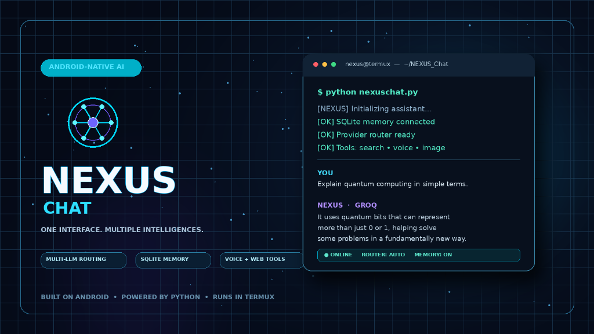
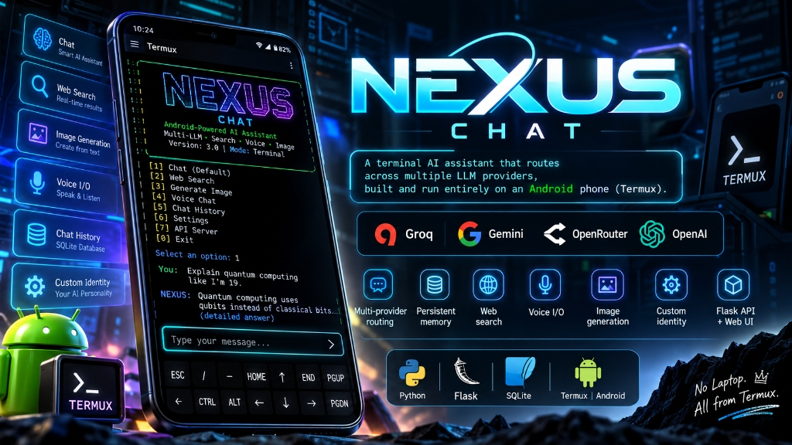
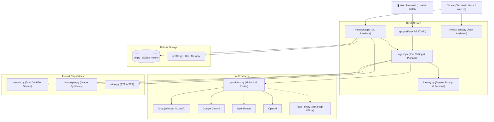

<p align="center">
  
</p>

# ⚡ NEXUS Chat

**A terminal AI assistant that routes across multiple LLM providers, built and run entirely on an Android phone (Termux).**

<p align="center">
  <a href="https://www.python.org/"></a>
  <a href="https://flask.palletsprojects.com/"></a>
  <a href="https://www.sqlite.org/"></a>
  <a href="https://termux.dev/"></a>
  <a href="https://github.com/tejasbargat16-ux/nexuschat"></a>
</p>

> No laptop. No cloud IDE. Every line written, tested and pushed from Termux.

<p align="center">
  
</p>

---

## ✨ Features

| Feature | Details |
|---|---|
| 🔀 **Multi-Provider Routing** | Route across **Groq**, **Gemini**, **OpenRouter**, **OpenAI**, **Mistral**, and **Cohere** behind a unified interface, with automatic fallback if a provider fails |
| 💾 **Persistent SQLite Memory** | Full conversation history stored in SQLite with session switching and history replay |
| 👤 **User Profile Memory** | Persistently remembers personal facts and preferences across sessions (`/remember`, `/profile`, `/forget`) |
| 🎙️ **Voice I/O** | Speech-to-text via Groq Whisper API and text-to-speech via Termux:API (Android) or `pyttsx3` (Desktop) |
| 🤖 **Hands-Free Task Assistant** | Integrated task runner (`Nexus_task.py`) with Wikipedia search and desktop app automation |
| 🔎 **Live Web Search** | Real-time DuckDuckGo web search integration to ground model answers |
| 🖼️ **Image Generation** | Generate AI images on-demand from chat or slash commands |
| ⚙️ **Agent Mode** | Safe shell execution with interactive confirmation before running any command |
| 📴 **Offline LLM Fallback** | Optional on-device offline fallback via `llama.cpp` when signal is unavailable |
| 🌐 **REST API & Web UI** | Flask API (`api.py`) allowing custom frontends (e.g. Lovable web UI) to connect to NEXUS |

---

## 🖥️ Terminal Interface & Commands

Launch NEXUS in your terminal:

```bash
python nexuschat.py
```

### Slash Commands

| Command | Action |
|---|---|
| `/new` | Start a new conversation |
| `/sessions` | List saved conversations |
| `/load <id>` | Resume a saved conversation |
| `/rename <title>` | Rename the current conversation |
| `/provider <name>` | Switch provider (`groq`, `gemini`, `openrouter`, `openai`, `mistral`, `cohere`) |
| `/model <name>` | Switch model within the current provider |
| `/models` | List suggested models for the current provider |
| `/health` | Live-probe every configured provider (key, endpoint, model, latency) |
| `/remember <fact>` | Save a fact about you for NEXUS to remember always |
| `/profile` | Show everything NEXUS remembers about you |
| `/forget all` | Erase all saved memory |
| `/agent on` \| `off` | Toggle agent mode (proposes shell commands with user approval) |
| `/voice on` \| `off` | Toggle voice mode (spoken responses and audio input) |
| `/task` | Launch dedicated hands-free voice task assistant (`Nexus_task`) |
| `/wiki <query>` | Query Wikipedia directly |
| `/search <query>` | Manually search the web right now |
| `/image <prompt>` | Generate an image from a description |
| `/clear` | Clear the terminal screen |
| `/exit` | Exit NEXUS Chat |

### Example Session

```text
$ python nexuschat.py
[NEXUS] Initializing assistant...
[OK] SQLite memory connected
[OK] Provider router ready
[OK] Tools: search • voice • image

YOU    Explain quantum computing in simple terms.
NEXUS · GROQ
       It uses quantum bits that can represent more than just 0 or 1,
       helping solve some problems in a fundamentally new way.

● ONLINE   ROUTER: AUTO   MEMORY: ON
```

---

## 🏗️ Architecture



### Modules Breakdown

| File | Role |
|---|---|
| `nexuschat.py` | Main terminal app, interactive menu, and slash command dispatcher |
| `Nexus_task.py` | Hands-free voice task assistant, Wikipedia search, and app opener |
| `providers.py` | Provider routing across Groq, Gemini, OpenRouter, OpenAI, Mistral, and Cohere |
| `agent.py` | Autonomous tool calling engine (web search, image generation, shell execution) |
| `identity.py` | Core system prompt and personality configuration |
| `db.py` | SQLite database schema and persistent conversation history |
| `profile.py` | Long-term user profile and preferences |
| `voice.py` | Speech-to-text via Groq Whisper and text-to-speech integration |
| `search.py` | Real-time web search retrieval |
| `imagegen.py` | AI image generation |
| `local_llm.py` | On-device offline fallback via `llama.cpp` |
| `api.py` | Flask REST API for connecting web and mobile frontends |

---

## 🔧 Engineering Decisions (Termux Constraints)

Building on an Android phone shaped the architecture:

- **Flask instead of FastAPI**: FastAPI dependencies pull in Rust-compiled packages (such as `pydantic-core`), which are painful and slow to build on Termux. Flask installs cleanly with zero native compilation overhead.
- **Plain `requests` instead of heavy SDKs**: Fewer dependencies, faster startup times, and one consistent method to call every provider.
- **Provider Abstraction Layer**: Model slugs get deprecated frequently; the defaults live in `providers.py` but can be overridden without touching Python via `models.json`.
- **Graceful Config Failure**: `models.json` is merged over the built-in defaults. A missing, malformed, or half-wrong file prints a warning and keeps the defaults — a bad config never stops NEXUS from starting.
- **Resilient Fallback Design**: If a provider is down or rate-limited, NEXUS automatically falls back to secondary cloud providers or a local offline GGUF model.

---

## 🚀 Setup & Installation

### 📱 Android (Termux)

```bash
# 1. Install base packages
pkg update && pkg install python git termux-api

# 2. Clone the repository
git clone https://github.com/tejasbargat16-ux/nexuschat.git
cd nexuschat

# 3. Install Python dependencies
pip install -r requirements.txt

# 4. Configure API keys
cp .env.example .env
nano .env

# 5. Run NEXUS Chat
python nexuschat.py
```

### 💻 Desktop (Linux / macOS / Windows)

```bash
# 1. Clone the repository
git clone https://github.com/tejasbargat16-ux/nexuschat.git
cd nexuschat

# 2. Install dependencies
pip install -r requirements.txt

# 3. Set API keys in .env
# Windows: copy .env.example .env
# Linux/macOS: cp .env.example .env

# 4. Run NEXUS Chat
python nexuschat.py
```

### 🎛️ Tuning Models & Fallback (`models.json`)

Model slugs, the default provider, the fallback order, and the request timeout
all live in `models.json`. Edit that file instead of editing Python:

```json
{
  "default_provider": "groq",
  "fallback_order": ["groq", "gemini", "openrouter"],
  "request_timeout": 60,
  "providers": {
    "groq": { "default_model": "openai/gpt-oss-120b" }
  }
}
```

Every key is optional — anything you omit keeps its built-in default. Invalid
entries are reported at startup and ignored, so a typo can't lock you out.

Check provider health at any time:

```bash
# In the terminal chat
/health

# Or against the running API
curl -H "X-API-Key: $NEXUS_API_KEY" http://127.0.0.1:8000/providers/health
```

Both make one tiny live request per configured provider, so they confirm the
key, endpoint, and model slug all work together — unlike a plain ping.

### 🌐 Starting the REST API Server

```bash
python api.py
# Running on http://127.0.0.1:5000
```

---

## 🗺️ Roadmap

- [x] Multi-provider routing with automatic fallback
- [x] Persistent SQLite memory and user profile system
- [x] Voice I/O (Whisper STT + TTS)
- [x] DuckDuckGo web search integration and image synthesis
- [x] Flask REST API for external frontends
- [x] Config-based models (`models.json`) instead of hardcoded slugs
- [x] Provider health checks (`/health`, `GET /providers/health`)
- [x] Automatic fallback shared by CLI, API and task runner
- [ ] RAG over user documents
- [ ] Multi-step agent workflows (tool planning)
- [ ] Polished web HUD frontend

---

## 🧰 Tech Stack

`Python` · `Flask` · `SQLite` · `Groq` · `Gemini` · `OpenRouter` · `OpenAI` · `Termux` · `Lovable` · `Rich`

---

## 👤 Author

**Tejas Bargat** — 2nd-year B.Tech ECE (Minor in CSE), TGPCET Nagpur  
[](https://github.com/tejasbargat16-ux)
[](https://www.linkedin.com/in/tejas-bargat-9ab8523b0)

---

⭐ If this project helped or inspired you, consider starring the repo!
